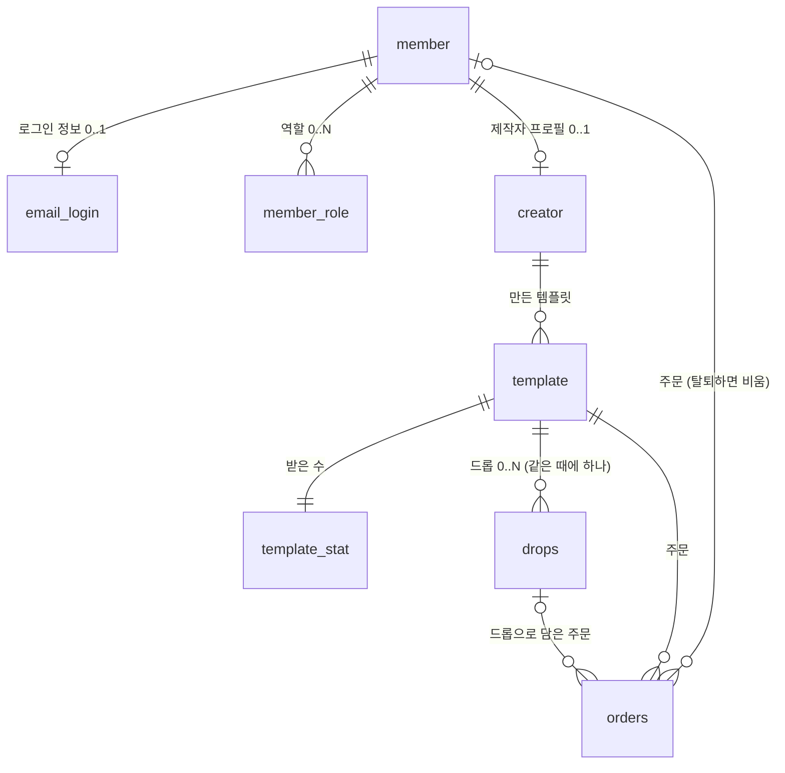

# ERD (v1)

- 날짜: 2026-11-14
- 상태: 승인 (2026-11-14 21:30, 정현). 최대 노력 검토 반영 뒤 승인. 승인 뒤 고침 1건(같은 날 밤, 정현의 질문에서): 3-1 링크 칸 일반화(`notion_url` → `link_url`, 형식 이름이 없는 CHECK). 11/15 껍데기에서 boolean과 `Instant` 칸이 validate를 통과하는 것을 확인하고(`Instant`를 UTC로 읽고 쓰는지는 4주 차에 확인), 역할을 코드에 담는 방법(2-3)과 카테고리 코드 이름(3-1)을 정했다
- 작성: 초안은 멘토 AI, 판단은 정현

> **쉽게 말하면**
> 1. 계정은 회원 / 이메일 로그인 정보 / 역할 / 제작자 프로필로 나눈다(ADR-0007 4-1). 탈퇴하면 회원 줄을 지우고 주문의 회원 칸만 비운다.
> 2. 템플릿 한 줄에 글 정보·상태·파일 키 또는 링크를 담고, 받은 수는 따로 표에 둔다(잃어버린 갱신 방지). 파일이나 링크로 받는 형식은 더해도 표가 그대로다.
> 3. 드롭은 템플릿 하나에 여러 번 열 수 있다(같은 때에 열린 것은 하나). 끝 시각·수량을 둘 다 비우면 상시 드롭(회원 전용)이다.
> 4. 주문은 "회원 + 템플릿"마다 하나이고, v1의 상태 값은 COMPLETED 하나다. 라이브러리 = 그 회원의 주문 목록.
> 5. 코드는 기능별 폴더(member, creator, template, order, drop)로 나누고, 다른 기능은 번호로만 가리킨다.
> 6. 목록은 쪽 번호로 나누고, 템플릿 상세 주소는 `/templates/{id}`다.
> 7. M2의 첫 템플릿은 Flyway 시드로 넣는다(썸네일 포함). 로그인할 수 없는 자리 회원에 묶었다가 4주 차에 진짜 공식 제작자 계정으로 옮긴다.
> 8. 가입 코드·재설정 토큰·세션·받은 수 1시간 세기 값은 Redis에 있어 표가 없다.

## 0. 공통 규칙

- DB는 MySQL 8.4. 표마다 `ENGINE=InnoDB DEFAULT CHARSET=utf8mb4 COLLATE=utf8mb4_0900_ai_ci`를 V1에 직접 적는다. 서버 기본값은 설정으로 바뀔 수 있고 운영 DB의 자리(7번)가 아직 정해지지 않아서, 로컬·테스트·운영이 같도록 기본값에 기대지 않는다.
  - `utf8mb4_0900_ai_ci`는 대소문자와 악센트를 모두 무시한다(é = e, ß = ss). B-3 제목 검색의 "영문 대소문자 무시"는 그대로 지켜진다. 이메일은 서로 다른 주소가 같은 계정으로 묶이지 않도록 가입 검증에서 ASCII만 받는다(4주 차, 요구사항 A-12에 한 줄).
- 표는 Flyway가 만들고 Hibernate는 검사만 한다(`ddl-auto: validate`, ADR-0003). Boot 4.1.2의 Hibernate는 7.4.13이다.
  - validate는 칸의 타입만 보고 VARCHAR 길이는 보지 않는다. 길이는 요청 DTO의 `@Size`가 V1과 같은 숫자로 지킨다(be-reviewer 체크).
  - V1을 엔티티에서 자동으로 뽑으면 enum은 `enum(...)`, boolean은 `bit`로 나온다. 이 문서의 규칙대로 고쳐 쓴다.
  - validate는 엔티티 → 표 방향으로만 본다. 표에만 있고 엔티티에 없는 칸은 잡지 못하므로, 엔티티를 쓸 때 V1과 칸 수를 직접 맞춘다(11/15 확인).
  - NULL 가능한 숫자 칸은 엔티티에서 래퍼 타입으로 쓴다(`template.file_size`·`orders.member_id`·`orders.drop_id`는 `Long`, `drops.quantity`는 `Integer`. 11/15 껍데기 때 정함). validate는 NULL 여부를 보지 않아 기본 타입(`long`)도 통과시킨다. 하지만 그러면 파일이 없는 템플릿을 저장할 때 `file_size`에 `0`이 들어가 `ck_template_file_together`에 걸리고, NULL인 줄을 읽을 때 오류가 난다.
- 기본 키는 `BIGINT` 자동 증가.
- 시각
  - 시각 칸은 `DATETIME(6)`에 UTC로 저장하고, 코드에서는 `Instant`로 다룬다(ADR-0006 결정 3). `TIMESTAMP`는 2038년에 끝나서 쓰지 않는다.
  - `Instant` ↔ `DATETIME(6)`은 validate를 통과한다(Hibernate 7.4.13 소스, 11/15 껍데기에서 실제로 확인). Hibernate는 `Instant`를 늘 UTC로 읽고 쓰므로(소스로 본 것) `hibernate.jdbc.time_zone`은 두지 않아도 된다 [확인 필요: 4주 차, 처음으로 시각을 저장하는 기능의 테스트에서 JVM 시간대를 한국으로 두고, 저장된 값을 SQL로 읽어 UTC인지].
  - **지금 시각은 앱이 만든다.** `NOW()`·`CURRENT_TIMESTAMP`는 DB 연결의 시간대 값이라, 운영 DB 설정에 따라 UTC 칸에 한국 시간이 섞일 수 있다. DDL 기본값, 시드, 쿼리 안의 "지금" 비교(R-8 드롭이 열렸나)에 쓰지 않는다. SQL에서 꼭 필요하면 `UTC_TIMESTAMP(6)`.
  - 앱의 "지금"은 `Clock` 빈 하나에서 만들고 마이크로초로 자른다(`truncatedTo(MICROS)`). 리눅스 JDK의 `Instant.now()`는 나노초까지 나와 `DATETIME(6)`에 넣으면 반올림되므로, 자르지 않으면 맥에서는 통과하고 CI에서만 깨지는 테스트가 생긴다. `created_at`·`updated_at`도 같은 Clock에서 만든다.
  - 앱 JVM의 시간대는 UTC로 둔다(7번에 넘김). Spring 패스키 표는 시각을 시간대 없이 넘기기 때문이다.
- enum은 이름(문자열)으로 저장한다(`VARCHAR`, JPA `@Enumerated(EnumType.STRING)`). 순서 번호(ORDINAL)는 값을 끼워 넣으면 저장된 뜻이 바뀌어 쓰지 않는다. MySQL의 `ENUM` 타입도 쓰지 않는다(값을 더할 때 표를 바꿔야 함).
  - Hibernate는 MySQL에서 `@Enumerated(STRING)` 칸으로 `ENUM` 타입을 기대하지만, 실제 칸이 `VARCHAR`이면 같은 것으로 보고 validate를 통과시킨다(Hibernate 7.4.13 소스, 통과는 11/15 껍데기에서 확인). `@Enumerated`를 빠뜨리면 순서 번호용 `tinyint`를 기대해 validate가 막는다(11/15 실험).
  - 예외: 런북에서 SQL로 직접 쓰는 `member.status`, `member_role.role`에는 `CHECK (… IN (…))`를 둔다. 오타가 들어가면 그 회원을 읽는 곳마다 오류가 나 로그인이 막히기 때문이다. 값을 더할 일이 드물어 CHECK를 고치는 비용이 작다. 카테고리·형식처럼 늘어날 값에는 두지 않는다.
- CHECK·유일 제약에는 이름을 붙인다(`ck_…`, `uk_…`). 오류를 받은 서버가 어느 규칙인지 구별할 수 있어야 한다(4-1).
- 표 이름 `order`·`drop`은 SQL 예약어라 `orders`·`drops`로 쓴다. `member`는 MySQL 8.4에서 예약어가 아니다. 엔티티는 `@Table(name = "orders")`처럼 표 이름을 직접 적는다.
- 칸 이름은 snake_case, 코드는 camelCase(Spring Boot의 기본 이름 전략, Hibernate `PhysicalNamingStrategySnakeCaseImpl`).

## 1. 그림



패스키 표 둘은 Spring Security의 모양을 따른다(그림 밖, 2-5).

## 2. 계정

### 2-1 member (회원)

| 칸 | 타입 | 규칙 | 근거 |
| --- | --- | --- | --- |
| id | BIGINT | PK | |
| nickname | VARCHAR(20) | NOT NULL, 겹쳐도 됨 | A-12 |
| status | VARCHAR(20) | NOT NULL, `ACTIVE` / `SUSPENDED`, CHECK(`ck_member_status`) | A-11. 탈퇴는 줄을 지우므로 상태가 아님(A-9) |
| terms_version | VARCHAR(20) | NOT NULL, 동의한 이용약관 버전 | A-12 |
| created_at, updated_at | DATETIME(6) | NOT NULL | |

- 만 14세 확인과 약관 동의를 하지 않으면 계정이 생기지 않으므로 "계정이 있다 = 확인했다"이다. 동의 시각은 `created_at`과 같다(정현 11/14, 가). 예외는 시드의 자리 회원뿐이고, 약관 버전에 `SEED`를 넣어 동의 기록이 아님을 표시한다(7번).
- 정지 사유·시각 칸은 두지 않는다. v1의 정지는 런북이다. 회원 관리 화면(v1 후보)을 만들 때 더한다.

### 2-2 email_login (이메일 로그인 정보) — member 1 : 0..1

| 칸 | 타입 | 규칙 | 근거 |
| --- | --- | --- | --- |
| member_id | BIGINT | PK + FK → member, 회원을 지우면 함께 지움 | ADR-0007 4-1 |
| email | VARCHAR(254) | NOT NULL, UNIQUE(`uk_email_login_email`), 앞뒤 공백을 빼고 소문자로 바꾼 값, ASCII만 | A-12 |
| password_hash | VARCHAR(255) | NOT NULL, `{bcrypt}…` 68자 | ADR-0009 |
| verified_at | DATETIME(6) | NOT NULL, 가입 코드를 맞힌 시각 | ADR-0008 결정 4 |

- 로그인 이름(`getName()`)은 이메일이다(ADR-0007 4-1). 이메일 바꾸기는 v2 후보다.
- 이메일 로그인 정보가 없는 회원은 로그인할 수 없다(소셜이 붙기 전에는 시드의 자리 회원뿐, 7번).
- 가입 마지막 단계를 두 번 누르면 두 번째 INSERT가 이메일 유일 제약에 걸린다. 4-1의 "유일 제약 오류를 다루는 방법"을 그대로 쓴다.
- 코드에서는 회원 번호를 기본 키로 함께 쓰는 1:1이다(`@Id Long memberId` + `@MapsId @OneToOne(fetch = LAZY) Member member`). 회원 쪽에서는 이 객체를 가리키지 않는다(한 방향). 저장할 때 회원의 번호를 기본 키로 복사하는 것이 `@MapsId`의 일이다.
  - `@MapsId`를 빠뜨려도 validate는 통과한다(Hibernate가 기본 키 칸에 걸린 1:1로 보고 넘어감, 11/15 실험). 빠뜨린 것은 저장할 때에야 드러나므로(기본 키가 채워지지 않음) 4주 차 가입 테스트가 잡는다 [확인 필요: 4주 차].

### 2-3 member_role (역할) — member 1 : N

| 칸 | 타입 | 규칙 |
| --- | --- | --- |
| member_id | BIGINT | FK → member, 회원을 지우면 함께 지움 |
| role | VARCHAR(20) | `CREATOR` / `ADMIN`, CHECK(`ck_member_role_role`) |

- PK = (member_id, role). 역할은 화면에서 주지 않고 런북으로만 붙인다(ADR-0007 4-2). 역할이 바뀌면 세션을 끊는다.
- 런북에서 CREATOR를 뗄 때는 제작자 프로필도 함께 정리한다. 프로필이 남아 있으면 2-4의 FK가 회원 삭제를 막아 탈퇴가 오류로 끝난다.
- **코드에서는 엔티티를 따로 두지 않고 `Member`의 값 묶음으로 담는다** (정현 11/15, 가): `@ElementCollection` + `@CollectionTable(name = "member_role")` + `@Enumerated(STRING) @Column(name = "role") Set<Role> roles`. 역할 줄은 (회원 번호, 역할) 두 칸뿐이라 혼자서는 뜻이 없고, 로그인할 때 "이 회원의 역할 목록"으로만 읽으며, 런북으로만 바뀐다. 역할 줄에 자기 정보(붙인 시각·붙인 사람)가 생기면 엔티티로 올린다. 엔티티로 바꾸는 것 자체는 표를 바꾸지 않고(같은 두 칸, 같은 기본 키), 새 정보의 칸만 다음 V 파일로 더한다.
  - 버린 안: 역할도 엔티티(`MemberRole` + 두 칸짜리 키 클래스). 클래스 둘과 키 클래스의 equals·hashCode가 더 생긴다.
  - 감수하는 것: "ADMIN인 회원 목록" 같은 조회도 회원을 거쳐 쓴다. 값 묶음의 "바꿀 때 전부 지우고 다시 넣기"는 순서 칸이 없는 `List`의 이야기이고, `Set`은 바뀐 줄만 지우고 넣는다(Hibernate 7.4.13 소스. 묶음을 새 `Set`으로 바꿔 끼우면 `Set`도 전부 다시 쓴다) [확인 필요: 앱에서 역할을 바꾸는 코드가 생길 때 SQL 로그로].

### 2-4 creator (제작자 프로필) — member 1 : 0..1

| 칸 | 타입 | 규칙 |
| --- | --- | --- |
| id | BIGINT | PK |
| member_id | BIGINT | NOT NULL, UNIQUE, FK → member, 회원을 지우지 못하게 막음 |
| name | VARCHAR(50) | NOT NULL, 공개 화면에 보이는 이름 [잠정: 길이] |
| bio | VARCHAR(500) | NULL 가능 [잠정: 길이] |
| official | BOOLEAN | NOT NULL, 공식 배지. MySQL에서는 `TINYINT(1)`로 만들어지고, 자바 `boolean`과 validate를 통과한다(11/15 확인. 드라이버가 `TINYINT(1)`을 BIT로 알려 주기 때문) |

- 템플릿은 회원이 아니라 이 프로필에 묶는다(ADR-0007 4-3). 공개 API는 이름과 공식 배지만 내보낸다.
- 공식 제작자 계정은 탈퇴하지 않는다(A-10). 그래서 프로필의 주인이 사라지는 일은 런북 안에서만 생긴다(7번의 옮기기, 2-3의 역할 떼기).

### 2-5 패스키 표 둘

- 운영 계정(ADMIN)만 쓴다. `/admin`에 들어갈 때의 추가 인증이다(ADR-0007 결정 5, O-4). 줄은 정현의 기기 몇 개뿐이다.
- Spring Security의 `JdbcPublicKeyCredentialUserEntityRepository`·`JdbcUserCredentialRepository`가 쓰는 표다. 7.1.x 원문(`user-entities-schema.sql`, `user-credentials-schema.sql`)을 확인했다(11/14). 원문은 H2용 기본판과 PostgreSQL판뿐이고, 기본 키가 `VARCHAR(1000)`이라 MySQL utf8mb4에서 4,000바이트가 되어 색인 한도(3,072바이트)를 넘는다. 그대로 옮기면 표가 만들어지지 않는다.
- **표·칸 이름은 원문 그대로(Spring 코드가 이 이름으로 SQL을 쓴다), 타입만 MySQL용으로 고쳐 옮긴다.**

| 표 | 칸 | 원문 | 우리 |
| --- | --- | --- | --- |
| user_entities | id (PK) | varchar(1000) | `VARCHAR(1000) CHARACTER SET ascii` (base64url 글자라 1,000바이트) |
| | name | varchar(100) | `VARCHAR(254)` (이메일 길이) |
| | display_name | varchar(200) | 그대로 |
| user_credentials | credential_id (PK) | varchar(1000) | `VARCHAR(1000) CHARACTER SET ascii` |
| | created, last_used | timestamp | `DATETIME(6)` (0번 규칙) |
| | 나머지(blob, boolean, varchar) | | 그대로 |

- 사용자 이름은 이메일(`getName()`)과 같다. 회원 표와 FK로 잇지 않는 Spring의 모양이라, 운영 계정의 패스키 정리는 런북이 한다.
- 5주 차: Testcontainers에서 실제로 한 번 등록·확인해 본다.

## 3. 템플릿·드롭

### 3-1 template (템플릿)

| 칸 | 타입 | 규칙 | 근거 |
| --- | --- | --- | --- |
| id | BIGINT | PK | |
| creator_id | BIGINT | NOT NULL, FK → creator | ADR-0007 4-3 |
| title | VARCHAR(100) | NOT NULL [잠정: 길이는 4주 차] | B-3, ADR-0010 결정 4 |
| description | VARCHAR(2000) | NOT NULL [잠정] | B-4 |
| format | VARCHAR(20) | NOT NULL, v1은 `NOTION` / `PPT`. 형식마다 받는 방식(파일·링크)이 하나 정해져 있다(아래) | B-2 |
| category | VARCHAR(30) | NOT NULL, 6개 중 하나 (코드 이름은 아래) | B-2, 용어 사전 |
| access_type | VARCHAR(20) | NOT NULL, `GENERAL` / `DROP_ONLY` (받는 조건), 기본 `GENERAL` | R-3, 정현 11/14 |
| status | VARCHAR(20) | NOT NULL, `DRAFT` / `PUBLISHED` / `UNPUBLISHED` (공개 전 / 공개 / 내림) | O-2 |
| first_published_at | DATETIME(6) | NULL 가능, 처음 공개한 시각(다시 공개해도 바뀌지 않음) | B-1 |
| file_key | VARCHAR(100) | NULL 가능, 창고의 키 `UUID.확장자` | ADR-0010 결정 4·7 |
| file_size | BIGINT | NULL 가능 | ADR-0010 결정 7 |
| file_content_type | VARCHAR(100) | NULL 가능 | ADR-0010 결정 7 |
| thumbnail_key | VARCHAR(100) | NULL 가능 | ADR-0010 결정 7 |
| link_url | VARCHAR(500) | NULL 가능, 링크로 받는 형식(노션 등)의 주소 | ADR-0010 결정 7, 정현 11/14 밤 |
| created_at, updated_at | DATETIME(6) | NOT NULL | |

- CHECK
  - `ck_template_file_or_link`: 파일과 링크를 동시에 갖지 않는다. `file_key IS NULL OR link_url IS NULL`. 둘 다 비어 있는 것은 된다(파일·링크는 나중에 붙여도 됨, C-1·D-9). 형식 이름을 적지 않으므로 형식을 더해도 이 CHECK를 고치지 않는다.
  - `ck_template_file_together`: 파일 칸 셋(키·크기·콘텐츠 타입)은 함께 비거나 함께 찬다. `(file_key IS NULL) = (file_size IS NULL) AND (file_key IS NULL) = (file_content_type IS NULL)`
  - `ck_template_published_at`: 공개 전(`DRAFT`)과 "처음 공개한 시각이 비어 있음"은 늘 같이 간다. `(status = 'DRAFT') = (first_published_at IS NULL)`
- **받는 방식은 형식이 정한다** (정현 11/14 밤, 가). 받는 방식(파일·링크, 용어 사전의 `DeliveryType`)은 칸으로 두지 않고, 코드의 형식 enum이 저마다 가진다: `PPT(FILE)`, `NOTION(LINK)`. 칸을 따로 두면 형식과 어긋날 수 있다. API 응답에서는 받는 방식을 내보낸다.
  - DB는 "둘 다 가지지 않음"까지만 막는다. "PPT인데 링크만 있음"처럼 형식과 반대쪽이 채워진 줄은 서버가 등록·수정 때 막는다(파일형이면 링크가 비어 있고, 링크형이면 파일 칸 셋이 비어 있음). 테스트를 한 줄씩 둔다.
  - 링크형은 `https` 주소만 받고, 형식마다 허용하는 도메인(노션이면 노션의 공개 도메인)을 둔다 [잠정: 4주 차]. 받는 사람이 누르는 주소라, 아무 사이트로 보내는 링크가 들어가지 않게 한다.
  - 형식 값 자체도 DB가 막지 않는다(0번 규칙, 카테고리와 같음). 모르는 값이 든 줄은 Hibernate가 읽을 때 오류를 낸다. 그래서 형식·카테고리는 코드와 시드로만 넣고, V2 시드의 값은 목록 API 테스트가 한 번 읽어 확인한다(9번).
- **형식 더하기** (정현 11/14 밤): 파일이나 링크로 받는 새 형식(엑셀, 워드, 키노트, 굿노트, 캔바, 구글 시트, 피그마 등)은 표를 바꾸지 않는다.
  - 할 일: 형식 enum에 한 줄(받는 방식 포함), 파일형이면 올릴 수 있는 형식 목록(ADR-0010 결정 4의 "허용 형식")에, 링크형이면 허용 도메인에 더하기, 화면의 형식 필터·표시, 요구사항 B-2의 형식 목록, 배포 한 번.
- **알려진 한계** (지금 만들지 않는다. 필요해지면 덧붙이는 마이그레이션으로)
  - 템플릿 하나에 파일 여러 개(본 파일 + PDF 미리보기, 판형별 파일): 파일 칸 셋을 `template_file` 표(템플릿 1 : N)로 옮긴다. v2 후보.
  - 글을 화면에서 바로 복사하는 방식(프롬프트·마크다운 틀): 본문 칸(`content_text`)을 더하고, CHECK를 "셋 중 하나 이하"로 바꾸는 새 V 파일 하나. 받는 방식에 `TEXT`가 생긴다.
  - 내 계정에 바로 넣어 주기(노션·구글 연동): 외부 서비스의 로그인 연동(OAuth)과 심사, 토큰 보관이 필요한 큰 기능이라 v2·v3.
- 받는 조건은 제작자가 고르지 않는다(C-1 그대로, 기본 `GENERAL`). `DROP_ONLY`로 바꾸는 것은 운영의 "드롭 열기"뿐이다(3-3).
- **카테고리 코드 이름** (정현 11/15 확정): `PLANNER`(플래너·일정), `STUDY`(공부·노트), `CAREER`(취업·커리어), `WORK`(업무·프로젝트), `LIFE`(생활·기록), `PRESENTATION`(발표·문서). 계약에 enum 값으로 실려 프론트 타입이 된다.
- 템플릿은 지우지 않고 내린다. 권리 문제로 파일을 지울 때도 줄은 남기고, 파일 칸 셋과 썸네일 키(링크형이면 링크)를 비우며 창고의 파일도 함께 지운다(D-7·D-9, ADR-0010 감수하는 것, 런북).
- 색인: `(status, first_published_at, id)` 목록 화면용, `creator_id` 제작자 화면용(FK에도 쓰임). 카테고리·형식 필터는 템플릿 수십 개 규모라 색인을 더 두지 않는다. v2 검색·정렬 측정 때 본다.
- 제목 검색은 `LIKE '%검색어%'`라 색인을 타지 않는다. 같은 이유로 v1에서는 그대로 둔다.
- 칸 수(14개 + 시각 둘)는 "물건 하나"를 담는 표로 평범한 편이고, 모든 칸이 이 템플릿에만 기대므로 정규화로 나눌 곳은 없다(정현의 질문, 11/14).

### 3-2 template_stat (받은 수) — template 1 : 1

| 칸 | 타입 | 규칙 |
| --- | --- | --- |
| template_id | BIGINT | PK + FK → template |
| download_count | BIGINT | NOT NULL, DEFAULT 0 |

- 템플릿을 만들 때 함께 한 줄을 만든다(시드도 마찬가지). 테스트: "템플릿을 만들면 받은 수 줄도 생긴다".
- 늘릴 때는 `UPDATE template_stat SET download_count = download_count + 1 WHERE template_id = ?` 한 가지 방법으로만 바꾼다(엔티티를 읽어 고쳐 쓰지 않는다). 바뀐 줄이 1이 아니면 ERROR 로그를 남긴다(줄이 없으면 숫자가 조용히 사라지므로, ADR-0004 결정 3의 "우리 잘못").
- 따로 두는 이유(잃어버린 갱신): JPA는 기본으로 줄 전체를 다시 쓰므로, 제작자가 글을 고치는 동안 늘어난 받은 수가 덮어써질 수 있다. 숫자는 이 표에서만 바뀌고, 글 수정과 섞이지 않는다. 받은 수를 셀 때와 글을 고칠 때 잠그는 줄도 달라 서로 기다리지 않는다(정현 11/14, 나).
  - 버린 안: 같은 표에 두고 그 칸만 쓰지 못하게 함(`@Column(insertable = false, updatable = false)`), 또는 `@DynamicUpdate`(바뀐 칸만 씀). 둘 다 덮어쓰기는 막지만, 잠금이 같은 줄에 걸리고 엔티티 설정 하나를 빠뜨리면 다시 생긴다.
- 1시간에 한 번 세기(회원 번호·IP 해시 + 템플릿)는 Redis에 둔다(ADR-0010 결정 3, D-3). v2의 좋아요 수도 이 표에 더할 수 있다.
- 코드에서는 2-2와 같은 공유 기본 키 1:1이다(`@Id Long templateId` + `@MapsId @OneToOne(fetch = LAZY) Template template`). `@MapsId`를 빠뜨린 것은 "템플릿을 만들면 받은 수 줄도 생긴다" 테스트(4주 차)가 잡는다.

### 3-3 drops (드롭) — template 1 : 0..N

| 칸 | 타입 | 규칙 | 근거 |
| --- | --- | --- | --- |
| id | BIGINT | PK | |
| template_id | BIGINT | NOT NULL, FK → template (UNIQUE 아님) | R-1, 정현 11/14 |
| opens_at | DATETIME(6) | NOT NULL, 여는 시각 | R-1, R-8 |
| ends_at | DATETIME(6) | NULL 가능, 기간 한정 | R-1 |
| quantity | INT | NULL 가능, 수량 한정 | R-1 |
| created_at | DATETIME(6) | NOT NULL | |

- CHECK: `ends_at > opens_at`, `quantity > 0`. 둘 다 비면 **상시 드롭**이다(끝이 없고 수량도 없음 → 화면은 "회원 전용"으로 보이고, 로그인한 회원이 한 번씩 담는다).
- 드롭 열기(O-3, 운영 화면)가 지키는 규칙. 두 표에 걸친 규칙이라 DB가 아니라 서버의 한 메서드가 지킨다.
  - 고를 수 있는 템플릿: 공개 전(`DRAFT`) 템플릿, 또는 이미 `DROP_ONLY`인 템플릿. 일반(`GENERAL`)으로 공개된 적 있는 템플릿은 고를 수 없다(이미 누구나 받아 갔는데 갑자기 "선착순"이 되지 않게).
  - 한 트랜잭션에서 템플릿을 `DROP_ONLY`로 바꾸고 드롭 줄을 만든다. 그래서 `DROP_ONLY` 템플릿에는 늘 드롭이 하나 이상 있다(드롭 없이 공개되어 아무도 못 받는 템플릿이 생기지 않음).
  - 같은 템플릿에서 기간이 겹치는 드롭은 열 수 없다(같은 때에 열린 드롭은 하나). 끝이 없는 상시 드롭이 있으면 그 템플릿에 새 드롭을 열 수 없다.
- 같은 템플릿을 다시 드롭하면(예: 매년 여름): 지난 드롭에서 받은 회원은 라이브러리에 그대로 있고 주문의 유일 제약(4-1) 때문에 다시 담지 않는다. 못 받은 사람만 새 드롭에서 담는다. 수량은 드롭마다 따로 센다(그 `drop_id`가 있는 주문 수).
- 드롭이 끝난 뒤 누구나 받게 풀기(R-7)는 `access_type`을 `GENERAL`로 바꾸는 한 방향이다(6주 차). 반대(일반 → 드롭)는 위 규칙대로 막는다.
- 남은 수량을 어떻게 셀지(칸으로 둘지, Redis로 할지)는 6주 차 8번(동시성 후보)에서 정한다. 수량을 먼저 줄이는 방식을 고르면, 유일 제약에 걸린 같은 계정의 두 번째 요청이 줄인 수량을 되돌려야 한다(R-6 "수량도 1만 준다").
- 시각 판정은 서버 시각으로 한다(R-8). 쿼리에 `NOW()`를 쓰지 않고 앱이 넘긴 시각과 비교한다(0번).
- 공개 전에 드롭을 고치는 화면은 v1에 없다. 잘못 열면 런북으로 고친다.

## 4. 주문

### 4-1 orders (주문)

| 칸 | 타입 | 규칙 | 근거 |
| --- | --- | --- | --- |
| id | BIGINT | PK | |
| member_id | BIGINT | NULL 가능, FK → member, 회원을 지우면 비움(`ON DELETE SET NULL`) | A-9 |
| template_id | BIGINT | NOT NULL, FK → template | |
| drop_id | BIGINT | NULL 가능, FK → drops, 드롭으로 담았을 때 | D-3, R-3 |
| amount | INT | NOT NULL, DEFAULT 0, 원 단위 | ADR-0002 |
| status | VARCHAR(20) | NOT NULL, v1은 `COMPLETED` 하나 | ADR-0002, 정현 11/14 |
| created_at | DATETIME(6) | NOT NULL | |

- UNIQUE `uk_orders_member_template (member_id, template_id)`: 같은 회원 + 같은 템플릿은 한 번만 담긴다(D-4). 드롭을 여러 번 열어도 "계정당 1개"(R-2)를 이 규칙이 막는다. MySQL은 NULL끼리 같다고 보지 않으므로, 탈퇴로 생긴 익명 주문이 여러 개여도 걸리지 않는다.
- `drop_id`가 있으면 그 드롭의 템플릿과 주문의 템플릿이 같아야 한다. FK는 이것을 모르므로 서버가 지키고 테스트 한 줄을 둔다.
- **유일 제약 오류를 다루는 방법** (동시에 두 번 받기, D-4 "500이 아님")
  - 받기 흐름 전체를 트랜잭션 하나로 묶지 않는다. 주문 저장만 주문 서비스의 짧은 트랜잭션으로 두고, 유일 제약 오류는 그 메서드 **밖**(받기 흐름)에서 잡아 "이미 담김"으로 바꾼 뒤 링크를 그대로 준다.
    - 이유: 트랜잭션 안에서 저장이 실패하면 Spring이 그 트랜잭션에 "롤백만 가능" 표시를 남긴다. 안에서 잡고 계속하면 커밋 때 `UnexpectedRollbackException`이 나 500이 된다. Hibernate도 예외가 난 세션은 계속 쓰지 말라고 한다.
  - 제약 이름이 `uk_orders_member_template`일 때만 "이미 담김"으로 바꾼다. 다른 무결성 오류까지 삼키지 않는다.
  - 주문 저장 트랜잭션 안에서는 INSERT 뒤에 실패할 수 있는 일을 하지 않는다. 첫 요청이 롤백되면 기다리던 다른 요청들이 서로 교착될 수 있다(MySQL 문서의 예).
  - 테스트(4주 차): 같은 회원이 동시에 3번 요청 → 주문 1건, 응답 3개 모두 링크.
  - 가입 마지막 단계 두 번 누르기(2-2), 6주 차 드롭 담기도 같은 방법을 쓴다.
- 라이브러리(D-6)는 `member_id`의 주문 목록이다. 유일 제약의 색인이 `member_id`로 시작하므로 따로 색인을 두지 않는다. 내린 템플릿도 보여 준다(D-7). 템플릿 정보는 주문 목록의 템플릿 번호들을 템플릿 서비스에 한 번에 묻는다(5번, 쿼리 2번).
- `drop_id`를 따로 두는 이유: 같은 템플릿에 드롭이 여러 번 열리거나 드롭이 끝난 뒤 일반으로 풀면(R-7), 한 템플릿에 여러 드롭의 주문과 일반 주문이 섞인다. 드롭 수량은 그 `drop_id`가 있는 주문 수다.
- 상태 값은 결제를 붙일 때 더한다(`PENDING`, `PAID`, `REFUNDED` 등. 이름으로 저장하므로 값 추가와 배포 한 번). 결제 흐름을 모른 채 미리 정하지 않는다(정현 11/14, 가).
- 탈퇴한 뒤 재가입하면 새 회원 번호를 받으므로 드롭을 다시 받을 수 있다(A-9).

## 5. 기능과 표 (ADR-0004의 기능 목록)

코드는 기능별 폴더로 나눈다(ADR-0004 결정 2). 표마다 주인 기능이 하나 있고, 그 표는 주인 기능의 코드만 직접 읽고 쓴다. 다른 기능이 필요하면 주인 기능의 application 서비스를 부른다.

```
dev.damda.
 member   : member, email_login, member_role   가입·로그인·내 정보·탈퇴
 creator  : creator                            → member
 template : template, template_stat            → creator      목록·상세·제작자 화면·공개·내리기
 order    : orders                             → template     받기 POST·라이브러리·다시 받기
 drop     : drops                              → template, order   드롭 열기·[라이브러리에 추가]
 global   : 보안 설정(패스키 표 둘은 Spring이 씀)

화살표 = "이쪽이 저쪽을 부른다". 거꾸로 가는 화살표가 없어 순환이 없다.
```

- **기능 경계를 넘을 때는 번호로 가리킨다**(정현 11/14, 가). `Order`는 `Long templateId`, `Long memberId`, `Long dropId`를 가진다. 같은 기능 안(회원 ↔ 이메일 로그인 ↔ 역할, 템플릿 ↔ 받은 수)은 객체로 가리킨다.
  - 이유: 객체로 가리키면 `drop → order`(담기)와 `order → drop`(Order 엔티티가 Drop을 가리킴)이 맞물려 순환이 생기기 쉽다. 번호로 가리키면 구조상 순환이 없고, ArchUnit의 "기능끼리 순환 금지"가 그대로 지켜진다. DDD에서 애그리거트 사이를 식별자로 참조하는 방식이다.
  - 대가: `order.getTemplate()` 같은 이동이 없다. 라이브러리 목록은 주문 목록을 읽은 뒤 템플릿 서비스에 번호 목록으로 한 번에(IN) 묻는다(쿼리 2번).
  - 버린 안: 객체로 가리키되 한 방향만(국내 JPA 강의에서 흔한 방식). 순환을 피하려면 "담기는 order에 둔다" 같은 배치 규칙이 더 필요하다.
- 탈퇴는 member 안에서 끝난다. 주문의 회원 칸 비우기는 DB의 `ON DELETE SET NULL`이 한다.

## 6. 목록과 주소

- **목록 나누기: 쪽 번호** (정현 11/14, 가). 응답은 `PagedModel`(`content` + `page`, ADR-0006). 정렬은 `first_published_at` 내림차순, 같으면 `id` 내림차순. 화면의 쪽은 1부터, API는 0부터(화면이 바꿔 보냄). 커서와의 비교는 v2 검색·정렬 측정 때 숫자로 한다(기획 3의 3-1). 바꾸더라도 응답의 `page` 부분만 바뀐다.
  - 목록 API는 `page`와 필터(`category`, `format`, `q`)만 받는다. 쪽 크기(20)와 정렬은 서버가 정한다. 컨트롤러에서 `Pageable`을 그대로 받으면 요청이 `size`(Spring 기본 최대 2,000)와 `sort`(아무 칸)를 정할 수 있고, 계약에도 열린다.
- **템플릿 상세 주소: `/templates/{id}`** (정현 11/14, 가). 한 번 정하면 바꾸지 않는다. 제목을 고쳐도 링크가 그대로다. 번호로 템플릿 수가 드러나지만 공개 목록에 이미 보이고, 공개 전·내린 템플릿은 번호를 알아도 열리지 않는다(B-6). API도 `/api/v1/templates/{id}`.
- **화면 목록** (정현 11/14)

| 구역 | 화면 | 주소 |
| --- | --- | --- |
| 공개 | 템플릿 목록(필터·검색) | `/` (`?category=&format=&q=&page=`) |
| | 템플릿 상세 | `/templates/{id}` |
| | 가입(이메일 → 코드 → 비밀번호·닉네임·약관 동의·만 14세 확인) | `/signup` |
| | 로그인 | `/login` |
| | 비밀번호 재설정 요청 | `/password-reset` |
| | 비밀번호 재설정 둘째 단계 [잠정: 4주 차, 링크 vs 코드. 링크면 토큰이 주소에 실리므로 접속 로그에 남지 않게(N-3)] | [잠정] |
| | 내 정보(닉네임, 비밀번호 바꾸기, 탈퇴) | `/me` |
| | 내 라이브러리 | `/library` |
| | 처리방침, 이용약관 | `/privacy`, `/terms` |
| 제작자 | 내 템플릿 목록, 등록, 수정 | `/studio`, `/studio/templates/new`, `/studio/templates/{id}/edit` |
| 운영 | 템플릿 공개·내리기 | `/admin/templates` |
| | 드롭 열기(고를 수 있는 템플릿은 3-3의 규칙대로) | `/admin/drops/new` |
| | 패스키 등록 [잠정: 5주 차] | [잠정] |

  - 가입 화면에서 이용약관은 동의를 받고(필수), 처리방침은 링크로 안내한다(동의 대상이 아님, A-1 [확인 필요: 5주 차]).
  - `/me`, `/library`, `/studio/**`, `/admin/**`는 robots.txt와 noindex로 검색에서 뺀다(N-12).
  - API 이름은 껍데기에서 정한다(기획 3의 5-1). 목록·상세는 #36에서 정했다(`GET /api/v1/templates`, `GET /api/v1/templates/{id}`, `contract/openapi.yaml`).

## 7. M2 데이터: Flyway 시드

- 시드 = 서비스를 처음 열 때 미리 넣어 두는 첫 데이터. M2에는 제작자 화면이 없으므로(4주 차) 첫 템플릿의 글 정보를 Flyway 파일로 넣는다(기획 3의 15번 10 확정).

```
db/migration/
  V1__create_tables.sql     표 만들기 (껍데기 때)
  V2__seed_templates.sql    첫 템플릿 (M2 배포 직전)
```

- 시드의 주인 (정현 11/14, 가):
  ```
  V2 시드:  member(닉네임 "damda", 약관 버전 "SEED", 이메일 로그인 정보 없음 → 로그인 불가)
            └ creator(이름 "damda", 공식 배지)
              └ template 여러 개 (PUBLISHED, 처음 공개한 시각, template_stat 0)
  4주 차 CREATOR 런북:
            정현이 네이버 메일로 일반 가입 → CREATOR 역할을 붙임
            → creator.member_id를 새 회원으로 바꿈 → 자리 회원 줄을 지움
  ```
  - 표 규칙(NOT NULL)을 그대로 지키고, 계정의 메일·비밀번호가 공개 저장소에 들어가지 않는다(ADR-0007 4-2, N-6).
  - 버린 안: `creator.member_id`를 비울 수 있게 함(주인 없는 프로필이 규칙상 허용되어 v2까지 구멍으로 남음).
- 시드에 넣는 것: 제목, 설명, 형식, 카테고리, `GENERAL`, `PUBLISHED`, 처음 공개한 시각, **썸네일 키**, 받은 수 0줄. 시각은 `UTC_TIMESTAMP(6)`(0번).
- **썸네일** (정현 11/14, 나. ADR-0010 결과가 넘긴 "M2·포트폴리오의 빈 썸네일")
  - 2주 차 7번에서 썸네일 버킷을 만들 때, 템플릿 시험 때부터 만든 썸네일을 `UUID.png` 이름으로 콘솔에서 올리고 파일마다 읽기를 공개한다(ADR-0010 결정 2·4). V2 시드에 그 키를 넣는다. API는 "설정값 앞부분 + 키"로 주소를 만들어 준다. CSP `img-src`에 창고 주소를 넣는다(N-12, 7번). [잠정: 30분~1시간]
  - 2주 차가 넘치면 M2는 빈 썸네일(화면의 기본 그림)로 가고, 11월 말 포트폴리오 전에 V3(키만 UPDATE)로 채운다.
  - 4주 차 제작자 화면의 수정으로 바꾸면 새 키가 된다.
- 파일·링크는 비워 두고 4주 차 제작자 화면의 수정으로 붙인다(C-1). M2에는 받기가 없다. 받을 것이 없는 템플릿의 받기는 "받을 수 없음"으로 답한다(D-9).
- 테스트 DB(Testcontainers)에도 시드가 들어간다. 테스트는 "표가 비어 있다"를 가정하지 않고 자기가 넣은 데이터로만 확인한다.
- **Flyway 규칙**
  - 병합한 V 파일은 고치지 않는다. Flyway는 실행한 파일의 체크섬을 기억해, 바뀌면 앱이 뜨지 않는다. 고칠 것은 다음 번호의 파일로 만든다.
  - 로컬 MySQL은 볼륨이 남아 있어(환경 구축 기록) M2 전이라도 같은 일이 생긴다. 병합 전에 V1을 고쳤다면 `backend/`에서 `docker compose down -v`로 지우고 다시 띄운다.
  - MySQL은 DDL을 되돌리지 못한다. 마이그레이션이 중간에 실패하면 바뀐 것을 손으로 되돌린 뒤 `repair`한다. 그래서 V3부터는 한 파일에 한 가지 변경만 넣는다.

## 8. 표가 없는 것 (Redis)

| 무엇 | 어디서 정함 |
| --- | --- |
| 세션(Spring Session, 회원별 색인 포함) | ADR-0007 결정 2 |
| 가입 코드·시도 횟수, 재설정 토큰 | ADR-0008 결정 4, ADR-0011 결정 2. 만료·횟수는 4주 차 |
| 같은 주소 다시 보내기 간격·하루 횟수, 레이트 리밋 | ADR-0011 결정 5, 11번 |
| 받은 수 1시간에 한 번 세기(회원 번호·IP 해시 + 템플릿) | ADR-0010 결정 3 |

## 9. 결과

- **껍데기(11/14~16)**: `V1__create_tables.sql`(#30, 이 문서의 2~4번, 패스키 표 제외), 5번의 기능 폴더와 엔티티 7개·enum(#32, validate 통과(boolean·`Instant` 칸 포함), Q 클래스 7개), 형식 enum이 받는 방식(FILE·LINK)을 가짐(3-1), 카테고리 코드 이름(3-1), 목록 API는 `page`·필터만(#36).
- **M2 직전(2주 차)**: `V2__seed_templates.sql`(그때까지 만든 공식 템플릿, 썸네일 키 포함)과, 시드의 형식·카테고리 값을 목록 API 테스트로 한 번 읽어 확인(3-1). 7번에서 썸네일 버킷과 업로드.
- **4주 차**: CREATOR 런북에 "시드 프로필 옮기기" 세 단계와 "역할을 뗄 때 프로필 정리", 제목·설명·이름 길이(DTO `@Size`와 V1을 같게), 이메일 ASCII 검증, `Clock`(마이크로초)과 `Instant`가 UTC로 저장되는지(0번), 테스트 규칙(시드가 있는 DB), 동시에 세 번 받기 테스트(D-4), 템플릿을 만들면 받은 수 줄도 생기는지, 탈퇴 때 지우기·비우기 테스트(A-9), 가입 때 이메일 로그인 정보의 기본 키가 회원 번호로 채워지는지(2-2), 등록·수정 때 형식과 받는 방식이 맞는지 검사와 링크의 `https`·허용 도메인(3-1).
- **5주 차**: 패스키 표 DDL(2-5의 표대로)과 Testcontainers에서 실제 등록 한 번, 운영 패스키 등록 화면.
- **6주 차(8번)**: 드롭의 남은 수량 세기(수량 되돌리기 포함), 기간이 겹치는 드롭 막기, 드롭이 끝난 템플릿을 일반으로 풀기(R-7), 드롭 흐름 그림(기획 3의 11/13 줄에서 옮김).
- **7번(운영 구성)**: 앱 JVM 시간대 UTC, 운영 DB 자리, A-9의 "복구 뒤 탈퇴 회원 다시 지우기" 재료. DB 안의 표로는 복구할 때 그 표도 옛날로 돌아가므로, 백업 방식(바이너리 로그로 시점 복구)이나 10번 로그(탈퇴한 회원 번호만, 백업 보관 기간보다 오래) 중에서 정한다.
- **요구사항** (이 문서와 같은 PR에서 고침, 11/16)
  - B-1의 [잠정: 11/13, 쪽 번호 vs 커서] → 쪽 번호.
  - 5번 표의 ERD 줄(ERD, 쪽 번호 vs 커서, 주문 상태, 화면 목록·주소 이름·템플릿 상세 주소 모양, M2 데이터 넣는 방법, "받는 길" 칸의 이름)을 지운다.
  - 템플릿 상세 주소 `/templates/{id}`를 B-4에 적는다.
  - R-1 "템플릿 하나에 드롭은 하나다" → "같은 템플릿에 드롭을 여러 번 열 수 있다. 같은 때에 열린 드롭은 하나다. 끝 시각·수량이 둘 다 없으면 상시 드롭이다." O-3에 "일반으로 공개된 적 있는 템플릿에는 드롭을 열 수 없다".
  - A-12에 "이메일은 ASCII만".
  - C-1 "파일(PPT) 또는 링크(노션)" → "파일(PPT 등) 또는 링크(노션 등)". D-2도 같은 뜻으로(파일형은 만료 링크, 링크형은 그 링크). B-2의 형식 목록(노션·PPT)은 v1의 값이라 그대로 둔다.
- **ADR**: ADR-0010 결정 7의 "노션 링크 주소"는 승인한 본문을 고치지 않고 이 문서 3-1에서 넓힌다(`link_url`, 링크형 형식 모두).
- **용어 사전** (보강 때): 받는 조건(access type: 일반·드롭 전용)과 드롭 조건(수량·기간·상시)을 나란히 적어 차이를 보인다. 템플릿 상태(공개 전·공개·내림), 받은 수, 시드, 자리 회원, 쪽 번호, 상시 드롭. "주문"의 [잠정: 설계 주간] → 확정(이 문서 4-1). "형식"에 "형식마다 받는 방식이 하나 정해져 있다(PPT → 파일, 노션 → 링크)".
- **이 문서로 닫힌 것**: ADR-0002 결과(주문의 상태와 표 구조), ADR-0004 결과(기능 목록, 5번), ADR-0008의 "회원 + 템플릿 중복 불가 [잠정]", ADR-0010 결과의 "M2 빈 썸네일"(7번).
- **v2**: 좋아요 수(template_stat), 회원 관리 화면의 정지 사유·시각, 이메일 바꾸기, 커서 비교, 템플릿 하나에 파일 여러 개(`template_file`), 글 복사(`content_text`). 계정 연동은 v2·v3.

## 정현의 판단 (대화에서 옮김)

> 정현의 말을 대화에서 옮겼다. 읽기 쉽게 조금 다듬었지만 뜻은 바꾸지 않았고, 정현이 말하지 않은 이유는 넣지 않았다.

- 계정 (11/14): "제가 보기엔 괜찮아 보이네요." 동의 기록은 추천대로 가(약관 버전만). "ERD도 마무리 단계에 흠이 있나 최대 노력으로 새 채팅에서 검토해보겠습니다."
- 받는 조건의 이름 (11/14): "그러면 가가 나을 것 같아요." → `access_type`
- 받은 수 (11/14): "따로 표로 두는 게 좋을 것 같아요." 이어서 "템플릿 자체의 속성도 실무에서 이정도면 평범한 편인가요? 좀 많은 편이라면 정규화가 가능한 부분이 있나요?"
  - 멘토의 답(요약): 물건 하나를 담는 표로 평범한 편이다. 모든 칸이 이 템플릿에만 기대므로 정규화로 나눌 곳은 없다. 형식에 따라 한쪽만 채워지는 파일 칸·노션 칸은 CHECK 제약으로 지킨다. (같은 날 밤 3-1에서 "파일과 링크를 동시에 갖지 않음"으로 넓힘)
- 주문 상태 (11/14): "가 대로 가는게 맞는 것 같아요." → `COMPLETED` 하나
- 목록과 주소 (11/14): "질문1과 2는 말씀대로 가로 가는게 지금은 나을 것 같네요." 화면 목록은 "당장의 제가 봤을 때는 괜찮은 것 같네요." 처리방침·이용약관이 따로 보는 페이지이고 가입 때 동의를 받는지 물었다 → 이용약관은 동의, 처리방침은 링크로 안내.
- M2 데이터 (11/14): "시드란게 뭔가요? 우선 읽어봤을 땐 가가 더 좋은 방안인 것 같아요."
- 최대 노력 검토 (11/14 밤, 새 채팅): [고침] 16개, [질문] 3개. 근거는 ADR 0001~0011·요구사항·용어 사전·기획 3·환경 구축 기록, MySQL 8.4 문서와 Boot 4.1.2·Hibernate 7.4.13·Spring Security 7.1.x 소스.
  - 질문 1(받는 조건을 누가·언제): 멘토의 처음 추천(드롭 열기가 공개 전 템플릿에만 한 번)에 정현이 물었다. "드롭으로 나온 템플릿이 기간이 끝나면 못 받게 되잖아요. 그 템플릿이 나중에 이벤트성이나 계절성으로 돌아오는 날에 다시 드롭으로 올릴 수 있나요? 드롭이었던 템플릿이 공개로 바뀔 수도 있고, 회원가입을 유도하는 상시 드롭 템플릿이 될 수도 있는데, 유연하게 적용될 수 있는 구조인가요?" 멘토가 처음 안으로는 셋 중 하나(일반으로 풀기)만 된다고 답하고, 템플릿 하나에 드롭 여러 번(겹침 금지)·상시 드롭·일반으로 공개된 적 있는 템플릿은 드롭 불가를 담은 바꾼 추천을 냈다. → "오케이 바꾼 추천이 좋네요."
  - 질문 2(기능 목록과 참조 방식): "가 가 좋은 것 같네요." → 기능 경계를 넘으면 번호로. 뒤에 "새 절: 기능과 표는 무슨 말인지 모르겠어요"를 물었고, 멘토가 기능별 폴더와 "표마다 주인 폴더, 다른 폴더는 번호로"로 풀어 답했다.
  - 질문 3(M2 썸네일): "오케이 나 좋은 것 같아요."
  - 정현이 더 물은 것: 패스키는 운영 계정에만 거는 특별 보안인가(그렇다, ADMIN의 `/admin` 추가 인증), 지금 ERD에 흠이 없나(검토에서 찾은 흠은 반영했고, 실제로 돌려 볼 곳 셋이 [확인 필요]로 남음).
- 승인 (11/14 21:30): "오케이 승인으로 바꿔주세요."
- 형식 늘리기 (11/14 밤, 승인 뒤 V1을 쓰기 전): "지금 짜여진 구조들이 PPT, 노션 말고도 템플릿 양식이 추가됐을 때에도 유연하게 동작하는 구조인가요?"
  - 멘토의 답(요약): 칸 이름(`notion_url`)과 CHECK 안의 형식 이름 때문에 형식을 더할 때마다 표를 고쳐야 한다. 칸을 `link_url`로 넓히고 CHECK에서 형식 이름을 빼는 가를 추천했다.
  - 이어서: "그렇게 하면 유연하게 동작 가능한거죠? 추가로 url, 다운로드 말고 다른 방식이 존재하거나 하진 않죠?" → 파일·링크로 받는 새 형식은 코드 한 줄과 배포로 된다. 글 복사와 계정 연동이라는 방식이 더 있지만 지금 만들지 않는다(3-1 알려진 한계).
  - 정현이 가를 말로 고르지는 않았고, 멘토가 질문의 흐름을 가로 읽어 반영했다. 다르면 V1 병합 전에 되돌린다. → 되돌리지 않고 V1(#30)에 그대로 들어갔다.
- 역할을 코드에 담는 방법 (11/15, 껍데기): `@MapsId`와 `@ElementCollection`을 구글에서 찾아본 뒤 "이 글을 보고 가로 하기엔 좀 리스크가 있을 것 같다는 생각이 드는데 멘토님은 어떻게 생각하세요?"를 물었다. 멘토가 "전부 지우고 다시 넣기"는 `List`일 때의 이야기이고, 역할은 값이 둘뿐이고 런북으로만 바뀌어 글이 말하는 "써도 되는 예외"에 맞으며, 표가 같아 나중에 엔티티로 올리기 쉽다고 답했다. → "오케이 그럼 가로 가실까요?"
- 카테고리 코드 이름 (11/15): "결정 2는 그대로 가도 좋을 것 같아요."
